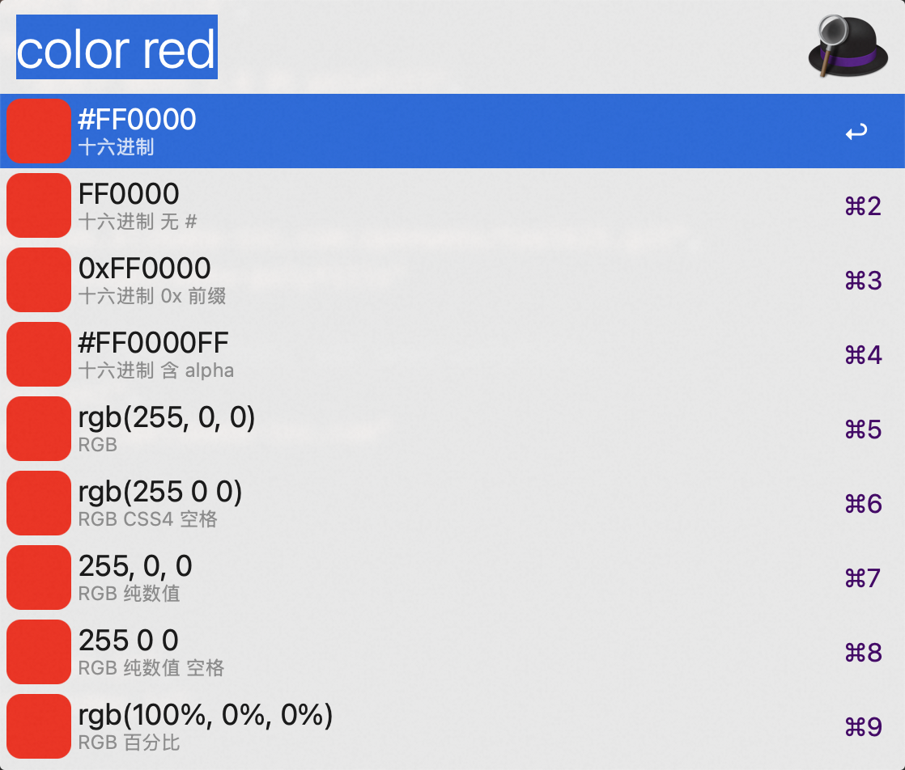

# Alfred-Workflow-Color

解析并转换颜色值。

[⤓ 下载 Workflow](https://github.com/CYJB/Alfred-Workflow-Color/releases/latest/download/color.alfredworkflow)

## 使用方法

使用 `color` 命令并输入任意常见写法的颜色值，下拉列表会显示该颜色在所有支持格式下的表示，回车即可复制到剪贴板。列表图标按当前颜色动态生成，半透明颜色会额外显示棋盘格衬底以便观察透明度。

支持的输入格式：

- 十六进制：`#RGB`、`#RGBA`、`#RRGGBB`、`#RRGGBBAA`，`#` 可以省略，也支持 `0x` 前缀，例如 `#FF00FF`、`0xFF00FF`、`FF00FF`。
- 函数式：`rgb()`、`rgba()`、`hsl()`、`hsla()`、`hsv()`、`hsb()`、`cmyk()`、`oklch()`、`oklab()`，同时支持 CSS Level 4 的空格与 `/ alpha` 语法和旧式逗号语法，例如 `rgba(255, 0, 255, 0.5)`、`rgb(255 0 255 / 50%)`、`oklch(0.7017 0.3225 328.36)`。
- CSS 颜色名(含 `transparent`)，例如 `rebeccapurple`。
- 裸数值：`255, 0, 255`、`255 0 255 / 0.5`。

## 结果项

下拉列表将每个格式的细节写法展开为独立的结果项，回车即复制该项内容，Alfred 会根据使用习惯自动维护结果项的顺序：

| 格式 | 包含的写法 |
| --- | --- |
| 十六进制 | `#FF00FF`、`FF00FF`、`0xFF00FF`、`#FF00FFFF`(含 alpha)，每项按住 `⇧` 切换大小写 |
| RGB | `rgb(255, 0, 255)`、CSS4 空格、纯数值(逗号/空格)、百分比、无空格 |
| RGBA | `rgba(255, 0, 255, 0.5)`、CSS4、CSS4 百分比 alpha、纯数值、百分比 alpha、十六进制(⇧ 小写) |
| HSL | `hsl(300, 100%, 50%)`、CSS4 `deg`、CSS4 空格、纯数值、无空格 |
| HSLA | `hsla(300, 100%, 50%, 0.5)`、CSS4、CSS4 百分比 alpha、纯数值、百分比 alpha |
| HSV | `hsv(300, 100%, 100%)`、`hsb()` 别名、纯数值、0~1 小数 |
| CMYK | `cmyk(0%, 100%, 0%, 0%)`、0~100 数值、纯数值、0~1 小数 |
| OKLCH | `oklch(0.7017 0.3225 328.36)`、百分比+`deg`、逗号、纯数值、含 alpha |
| OKLAB | `oklab(0.7017 0.2746 -0.1692)`、百分比 L、纯数值 |
| CSS 颜色名 | 颜色名，按住 `⇧` 切换首字母大写 |

与输入完全一致的写法不会重复出现在列表中(例如输入 `#FF00FF` 时，十六进制一项会直接显示为 `#ff00ff`)。

输入的颜色不是精确的 CSS 颜色名时，颜色名一项复制的仍是最接近的颜色名，但副标题会按照输入使用的格式额外显示该颜色名对应的实际值(例如输入 `oklch(0.45 0.19 260)` 时显示 `实际值 oklch(0.4143 0.1248 286.04)`)，便于确认与输入颜色的差异。

## 实现

所有逻辑均使用 JXA (JavaScript for Automation) 编写，各色彩空间的互转算法参考 [chroma-js](https://github.com/gka/chroma.js)。列表图标在运行时使用 AppKit 绘制为 PNG，并按颜色值缓存到 `alfred_workflow_cache` 目录。
